\# Azure Academy

An interactive learning platform for Azure, built from scratch and hosted on Azure. Lessons are laid out like an architecture diagram: every lesson is a resource you "deploy", and finishing a path completes the whole architecture.

**Live site:** [victorious-coast-0e2e4d00f.1.azurestaticapps.net](https://victorious-coast-0e2e4d00f.1.azurestaticapps.net)

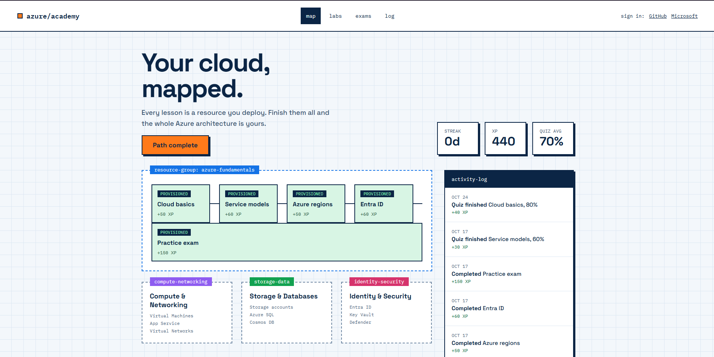

## Features

- **Learning map:** a dashboard styled like an architecture diagram, where each lesson shows as `PROVISIONED`, `DEPLOYING` or `NOT STARTED`
- **Lessons** with Azure service examples, analogies and hands-on lab prompts
- **Quizzes** with instant feedback and an explanation for every answer, plus a 10-question practice exam
- **Progress tracking:** XP, daily streak, quiz scores and an activity log
- **Sign in with GitHub or Microsoft (Entra ID):** progress is saved to your account in the cloud and follows you across devices. Without signing in, progress is kept in the browser.
- **Content as data:** lessons and quizzes live in JSON files, so adding content doesn't require changing code

The first learning path, Azure Fundamentals (AZ-900), is complete: four lessons with quizzes (Cloud basics, Service models, Azure regions, Entra ID) and a practice exam.

| Lesson page | Quiz feedback |
|---|---|
| 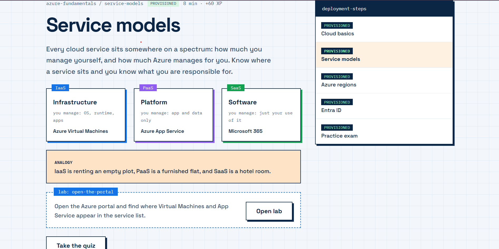 | 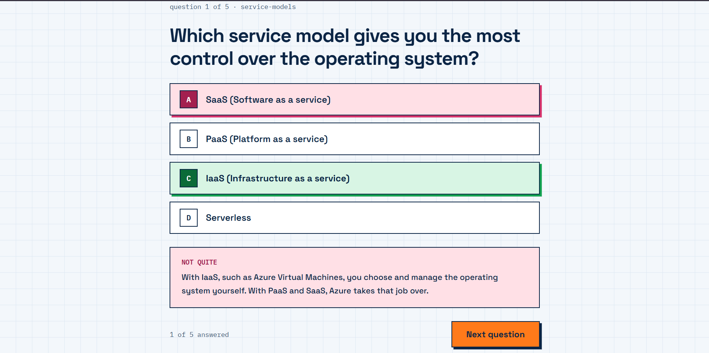 |

## Architecture

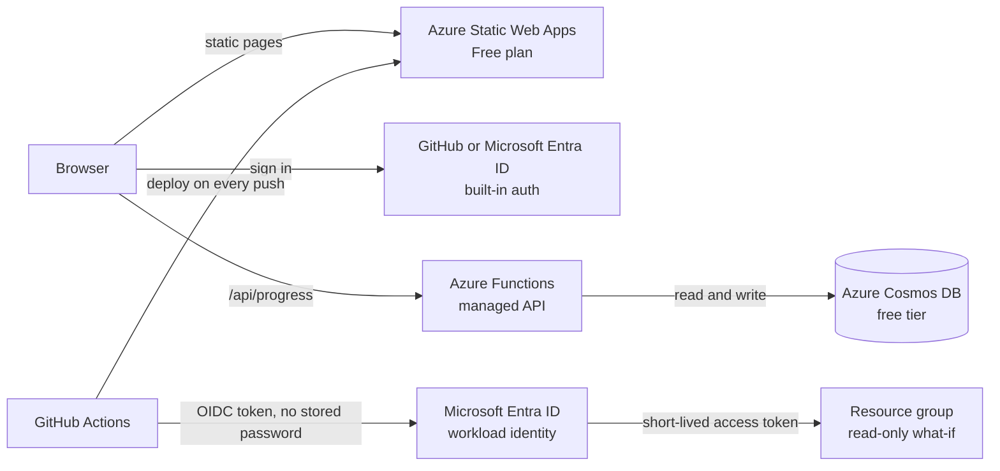

## Azure services used

| Service | Used for | Cost |
|---|---|---|
| Azure Static Web Apps (Free plan) | Hosting the site and the API, plus preview environments for pull requests | Free plan |
| Azure Functions (managed with Static Web Apps) | Serverless API for saving and loading progress | Included with the Free plan |
| Azure Cosmos DB for NoSQL (free tier) | Stores each learner's progress | Free tier, throughput capped inside the free allowance |
| Microsoft Entra ID | Built-in sign-in for learners, and a workload identity for the CI pipeline | Included |
| Azure Policy, resource locks, tags | Governance and protection against accidental deletion | No charge |
| Azure Advisor | Reviewing recommendations | Free |
| Azure Cost Management | Budget alert to catch unexpected spending | Free |
| GitHub Actions | Deployment, validation and what-if checks | Free |

Everything is deliberately kept inside free allowances, with a budget alert in Azure Cost Management.

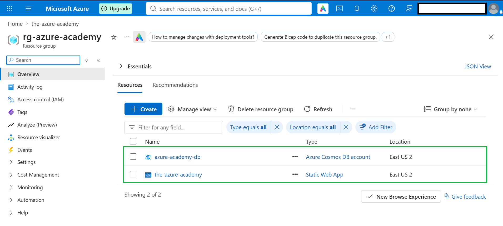

## Security and privacy

- The API route that handles progress **requires sign-in**. Azure checks the identity before the function runs.
- The learner's ID comes **only** from the identity Azure attaches to the request, never from the request body, so one user can't read or overwrite another user's data.
- The database stores an **anonymous ID plus progress data**. It holds no names or email addresses.
- Incoming data is **validated and size-limited** before it is saved.
- The database connection string lives in the Static Web App's **application settings**, never in the repository.
- The CI pipeline signs in to Azure with **OIDC**, so no Azure password or secret is stored in GitHub (details below).
- **Security headers:** a Content-Security-Policy restricts scripts to the site's own files and limits fonts and network requests to known origins. The site also sends X-Frame-Options, X-Content-Type-Options, Referrer-Policy, Permissions-Policy and Strict-Transport-Security. The changes were tested on a pull request preview before going live.

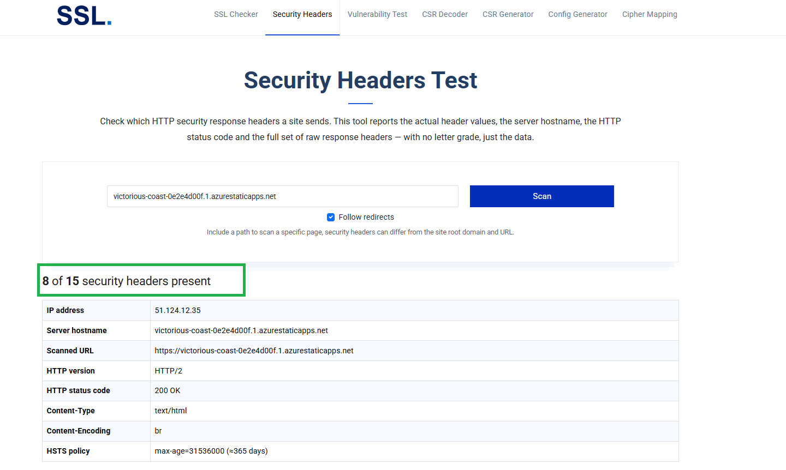
*Response headers returned by the deployed site.*
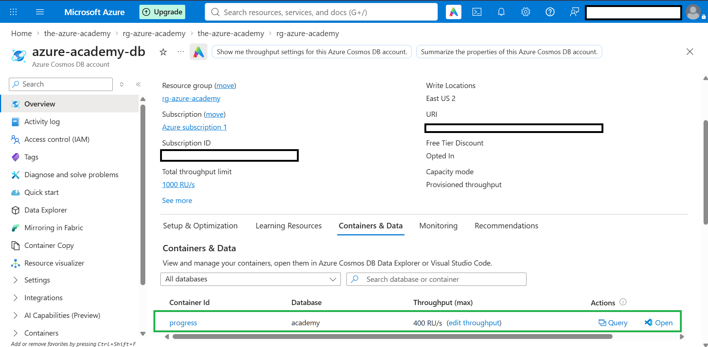

## Reliability and governance

- **Backups:** Cosmos DB uses continuous backup (7-day retention) for point-in-time restore.
- **Delete lock:** the resource group has a "Can't delete" lock, so the database can't be removed by accident.
- **Tags:** resources are tagged `project=azure-academy` and `environment=learning`, so costs can be filtered by project.
- **Policy:** I practiced Azure Policy in a separate sandbox resource group, with a built-in "Allowed locations" policy that blocks resources outside one region.
- **Advisor:** I reviewed the recommendations and weighed the cost of each one before acting. For example, I checked which continuous backup tier is free before switching.

| Delete lock | Policy blocking a disallowed region |
|---|---|
| 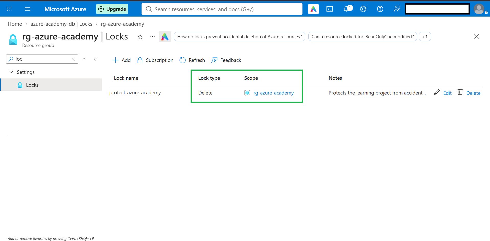 | 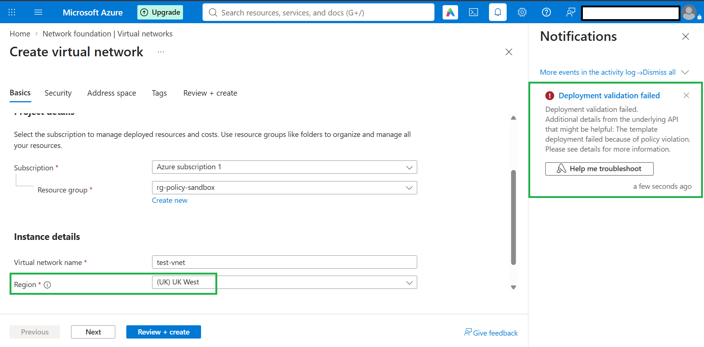 |
## Hands-on: access control with Entra ID

To practice Microsoft Entra ID outside the app, I created a test user and gave it the built-in **Reader** role on the project's resource group, so it can view the resources but not change them. It's a small example of least privilege, and of the difference between authentication (the user exists) and authorization (what the user can do).

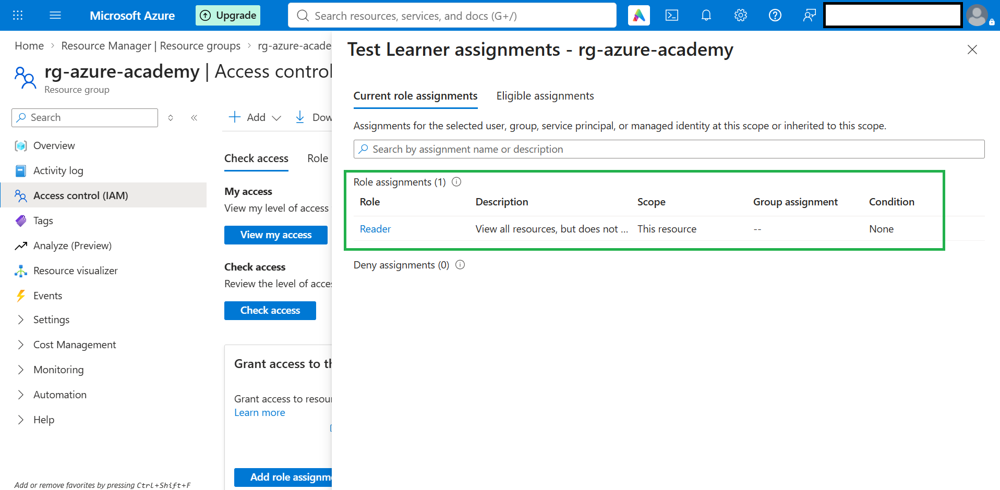

## CI/CD and infrastructure as code

- Every push to `main` builds and deploys the site and the API through GitHub Actions.
- Pull requests get their own **preview environment**, which is deleted when the pull request is closed.
- The Azure setup is described as code in [`infra/main.bicep`](infra/main.bicep) and checked by a GitHub Actions workflow on every change. The file documents the setup and could rebuild it. It is deliberately not deployed automatically: the real resources already exist, and a second free-tier Cosmos DB account would not be free.

| Successful deployment run | Production and preview environments |
|---|---|
| 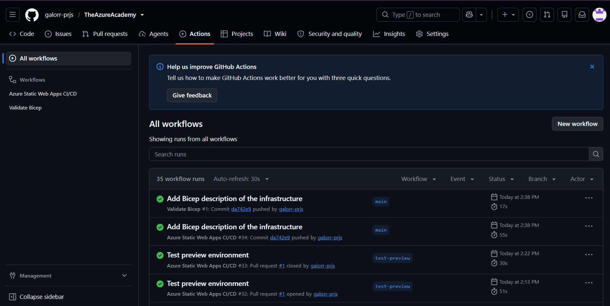 | 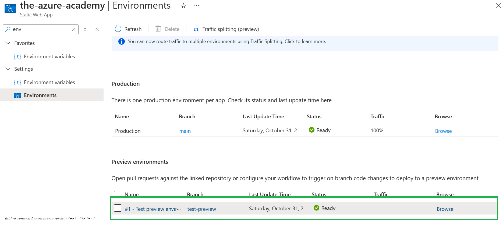 |

### Passwordless sign-in from GitHub to Azure (OIDC)

A second workflow runs `az deployment group what-if`, which compares the Bicep file with the real resource group and changes nothing.

- **Workload identity:** an app registration in Entra ID represents the pipeline, with a **federated credential** that trusts only workflows from this repository's `main` branch, using GitHub's immutable subject format (owner and repository IDs).
- **No stored secret:** GitHub issues a short-lived token for each run, and Azure exchanges it for a short-lived access token. There is no password or client secret to leak or rotate.
- **Least privilege:** a custom role on the one resource group allows reading and running what-if, and nothing else, so the pipeline cannot change or delete resources.
- **Result:** the first run found drift between my hand-written file and the real setup (the account's throughput cap, automatic failover, tags that Azure adds itself, and the Static Web App's GitHub connection). I corrected the file, so it now records what actually exists.

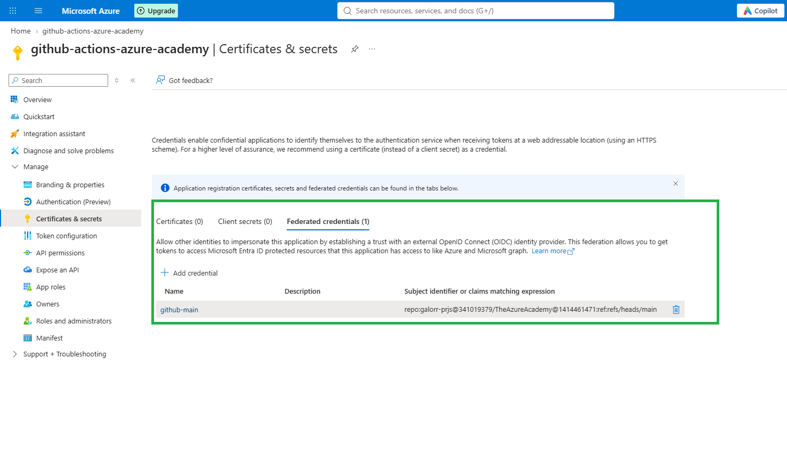
*The pipeline's identity has no certificates and no client secrets. Its only credential is a federated trust that accepts tokens from this repository's `main` branch.*

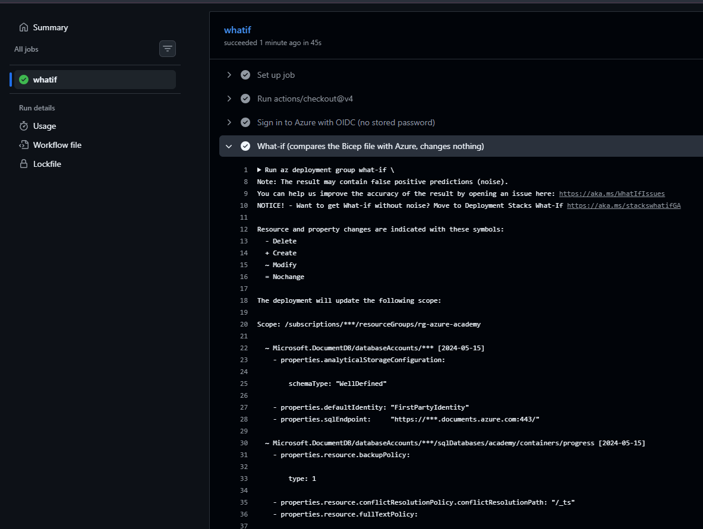
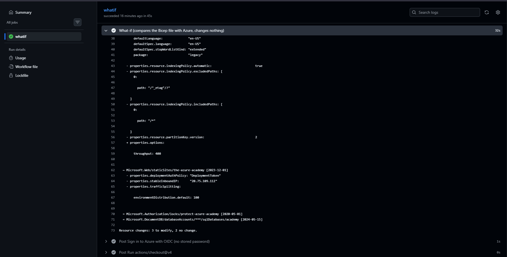
*A GitHub Actions run signs in to Azure with OIDC and compares the Bicep file with the real resource group. The "modify" counts come from default values that Azure fills in itself (the `-` rows). The real differences found in the first run were corrected in the file.*

## Decisions and trade-offs

- **Free tier first.** Every service was checked against Microsoft's current free allowances before use, and the Cosmos DB account was created with the free tier and a throughput cap. Azure has no hard spending cap on pay-as-you-go, so a budget alert and regular cost checks stand in for one.
- **Managed API.** Static Web Apps' managed Functions keep deployment simple and free. The trade-off is that they only respond to web requests, and I have found no way to give them a managed identity on the Free plan, so the database connection uses a connection string stored in app settings.
- **Browser-first progress.** Progress works without an account and syncs to the cloud after sign-in. If a signed-in account already has cloud progress, that copy wins over the one in the browser.
- **Describe, don't deploy.** The Bicep file is checked but not deployed, as explained above.
- **Security headers.** The Content-Security-Policy restricts scripts to the site's own files and limits fonts and network requests to known origins. Styles still allow `'unsafe-inline'`, because some elements get their colors from data through inline style attributes. A planned cleanup would move those into CSS classes so the policy can drop it.
## Tech stack

- HTML, CSS and vanilla JavaScript on the front end, with no framework or build step
- Node.js 20 and the Azure Functions v4 programming model for the API
- JSON files for lesson and quiz content
- GitHub Actions for deployment, validation and what-if checks
- Bicep for infrastructure as code

## How it works

1. `data/lessons.json` and `data/quizzes.json` describe the learning paths, lessons and quizzes.
2. The pages (`index.html`, `lesson.html`, `quiz.html`) read that data and build themselves in the browser.
3. `js/progress.js` stores progress in the browser and, when signed in, syncs it with `/api/progress`.
4. The API (`api/`) reads and writes one Cosmos DB item per learner.
5. A GitHub Actions workflow publishes the `app/` folder and the `api/` folder to Azure Static Web Apps whenever `main` changes.

## Run it locally

```bash
git clone https://github.com/galorr-prjs/TheAzureAcademy.git
cd TheAzureAcademy
python -m http.server 8080 --directory app
```

Then open http://localhost:8080. The pages must be served over HTTP, because opening `index.html` directly blocks loading the JSON data. Locally, progress is stored in the browser only. Sign-in and cloud sync work on the deployed site.

## Project structure

```
app/
  index.html               dashboard (learning map)
  lesson.html              lesson page
  quiz.html                quiz page
  staticwebapp.config.json route protection and API runtime
  css/styles.css           blueprint-style design
  js/
    app.js                 dashboard logic
    lesson.js              lesson page logic
    quiz.js                quiz logic
    progress.js            saved progress and cloud sync
  data/
    lessons.json           paths and lessons
    quizzes.json           quiz questions
api/
  host.json                Functions host settings
  package.json             dependencies
  src/functions/
    health.js              health check endpoint
    progress.js            read and save progress
  src/helpers/
    auth.js                reads the signed-in user
    cosmos.js              Cosmos DB connection
infra/
  main.bicep               the Azure setup described as code
Screenshots/               images used in this README
docs/                      early MkDocs lesson drafts (not published)
.github/workflows/
  azure-static-web-apps-*.yml   build and deploy to Azure Static Web Apps
  validate-bicep.yml            checks the Bicep file
  bicep-whatif.yml              compares the Bicep file with Azure, via OIDC
```

## Roadmap

- [x] Static hosting on Azure with automatic deployment
- [x] Serverless API with Azure Functions
- [x] Cosmos DB for saved progress, with GitHub and Microsoft sign-in
- [x] Hands-on access control with Entra ID
- [x] Governance basics: tags, lock, Azure Policy
- [x] Preview environments for pull requests
- [x] Azure Fundamentals path and practice exam
- [x] Infrastructure described as code with Bicep
- [x] Passwordless GitHub-to-Azure sign-in with OIDC, and a what-if check
- [x] Security headers
- [ ] Remove 'unsafe-inline' from the style policy
- [ ] Monitoring with Application Insights
- [ ] Admin role using Static Web Apps invitations
- [ ] Compute & Networking, Storage & Databases and Identity & Security paths
- [ ] Certificate of completion for finished paths

## Author

Built by [Gal Orr](https://github.com/galorr-prjs).
