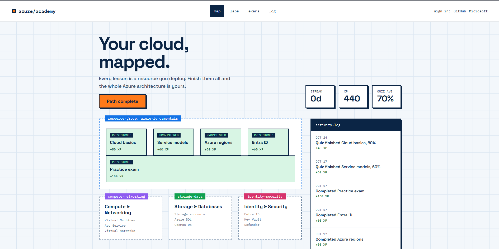
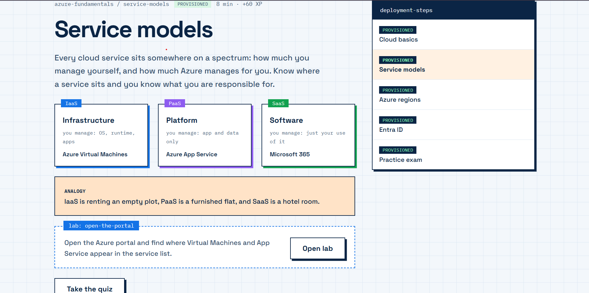
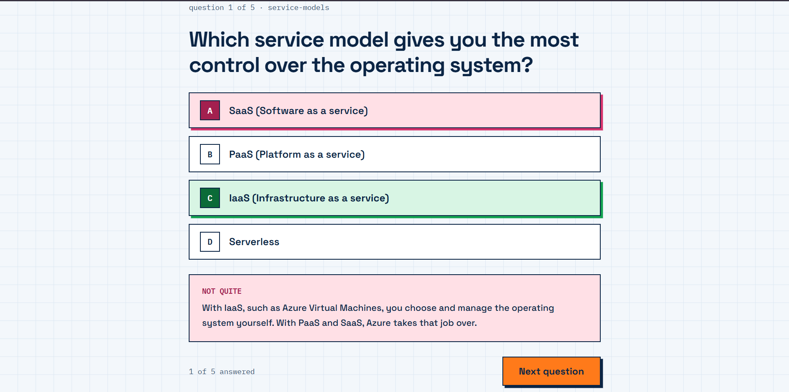
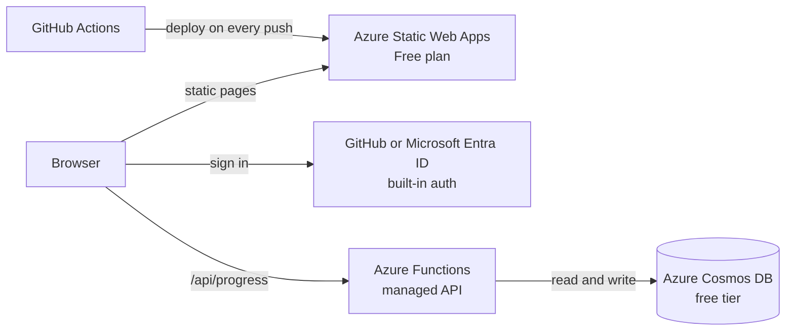
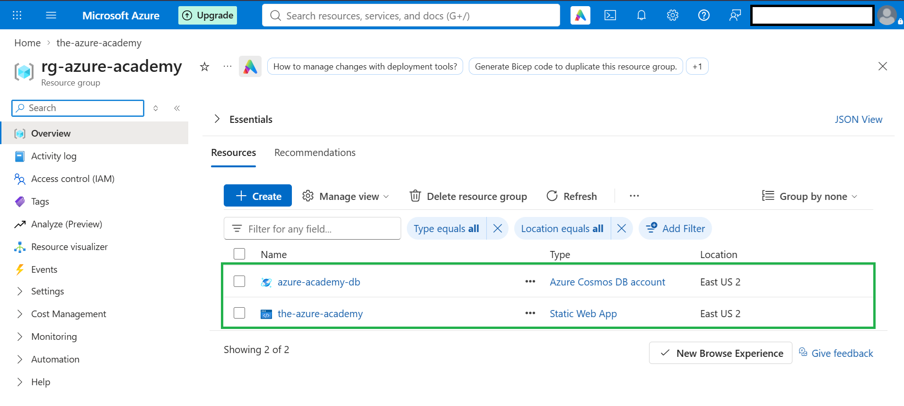
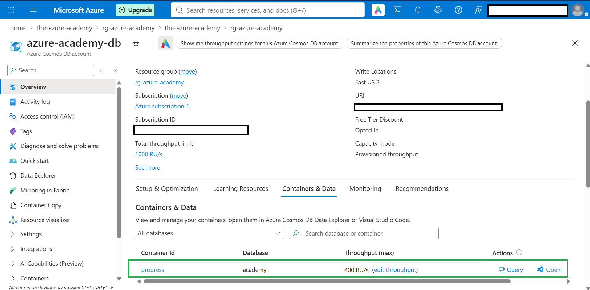
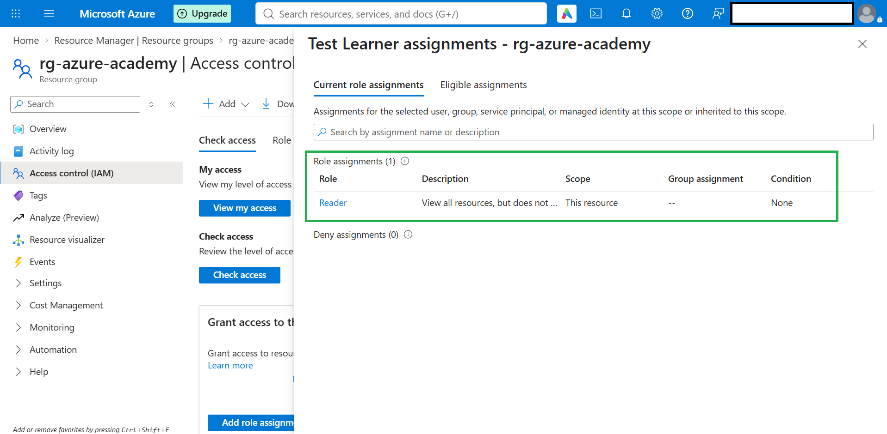
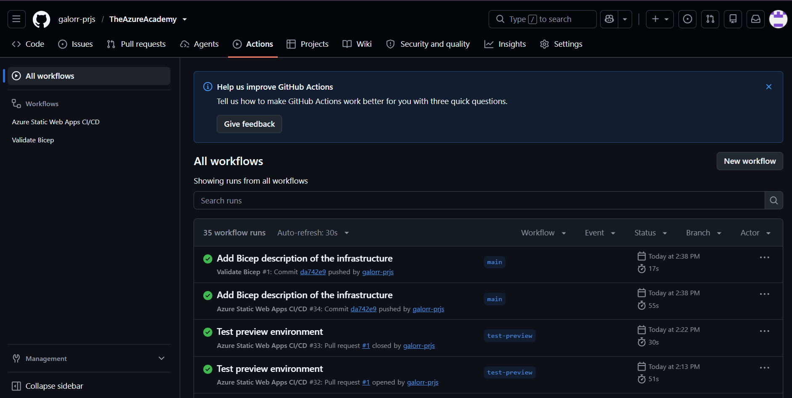

# Azure Academy

An interactive learning platform for Azure, built from scratch and hosted on Azure. Lessons are laid out like an architecture diagram: every lesson is a resource you "deploy", and finishing a path completes the whole architecture.

**Live site:** [victorious-coast-0e2e4d00f.1.azurestaticapps.net](https://victorious-coast-0e2e4d00f.1.azurestaticapps.net)



## Features

- **Learning map:** a dashboard styled like an architecture diagram, where each lesson shows as `PROVISIONED`, `DEPLOYING` or `NOT STARTED`
- **Lessons** with Azure service examples, analogies and hands-on lab prompts
- **Quizzes** with instant feedback and an explanation for every answer
- **Progress tracking:** XP, daily streak, quiz scores and an activity log
- **Sign in with GitHub or Microsoft (Entra ID):** progress is saved to your account in the cloud and follows you across devices. Without signing in, progress is kept in the browser.
- **Content as data:** lessons and quizzes live in JSON files, so adding content doesn't require changing code

The first learning path, Azure Fundamentals (AZ-900), is in progress. Four lessons with quizzes are done (Cloud basics, Service models, Azure regions and Entra ID), and a practice exam is next.

## Screenshots

| Lesson page | Quiz feedback |
|---|---|
|  |  |

## Architecture



## Azure services used

| Service | Used for | Cost |
|---|---|---|
| Azure Static Web Apps (Free plan) | Hosting the site and the API | Free plan |
| Azure Functions (managed with Static Web Apps) | Serverless API for saving and loading progress | Included with the Free plan |
| Azure Cosmos DB for NoSQL (free tier) | Stores each learner's progress | Free tier, throughput capped at 400 RU/s |
| Microsoft Entra ID (built-in sign-in) | Sign in with a Microsoft account | Included with the Free plan |
| GitHub sign-in (built-in) | Sign in with GitHub | Included with the Free plan |
| Azure Cost Management | Budget alert to catch unexpected spending | Free |
| GitHub Actions | Automatic deployment | Free |

Everything is deliberately kept inside free allowances, with a budget alert set in Azure Cost Management.



## Security and privacy

- The API route that handles progress **requires sign-in**. Azure checks the identity before the function runs.
- The learner's ID comes **only** from the identity Azure attaches to the request, never from the request body, so one user can't read or overwrite another user's data.
- The database stores an **anonymous ID plus progress data**. It holds no names or email addresses.



- Incoming data is **validated and size-limited** before it is saved.
- The database connection string lives in the Static Web App's **application settings**, never in the repository.

## Hands-on: access control with Entra ID

To practice Microsoft Entra ID outside the app, I created a test user and gave it the built-in **Reader** role on the project's resource group, so it can view the resources but not change them. It's a small example of least privilege, and of the difference between authentication (the user exists) and authorization (what the user can do).



## CI/CD

Every push to `main` builds and deploys the site and the API through GitHub Actions.



## Tech stack

- HTML, CSS and vanilla JavaScript on the front end, with no framework or build step
- Node.js 20 and the Azure Functions v4 programming model for the API
- JSON files for lesson and quiz content
- GitHub Actions for deployment

## How it works

1. `data/lessons.json` and `data/quizzes.json` describe the learning paths, lessons and quizzes.
2. The pages (`index.html`, `lesson.html`, `quiz.html`) read that data and build themselves in the browser.
3. `js/progress.js` stores progress in the browser and, when signed in, syncs it with `/api/progress`.
4. The API (`api/`) reads and writes one Cosmos DB item per learner.
5. A GitHub Actions workflow publishes the `app/` folder and the `api/` folder to Azure Static Web Apps whenever `main` changes.

## Run it locally

```bash
git clone https://github.com/galorr-prjs/TheAzureAcademy.git
cd TheAzureAcademy
python -m http.server 8080 --directory app
```

Then open http://localhost:8080. The pages must be served over HTTP, because opening `index.html` directly blocks loading the JSON data. Locally, progress is stored in the browser only. Sign-in and cloud sync work on the deployed site.

## Project structure

```
app/
  index.html               dashboard (learning map)
  lesson.html              lesson page
  quiz.html                quiz page
  staticwebapp.config.json route protection and API runtime
  css/styles.css           blueprint-style design
  js/
    app.js                 dashboard logic
    lesson.js              lesson page logic
    quiz.js                quiz logic
    progress.js            saved progress and cloud sync
  data/
    lessons.json           paths and lessons
    quizzes.json           quiz questions
api/
  host.json                Functions host settings
  package.json             dependencies
  src/functions/
    health.js              health check endpoint
    progress.js            read and save progress
  src/helpers/
    auth.js                reads the signed-in user
    cosmos.js              Cosmos DB connection
docs/                      early MkDocs lesson drafts (not published)
.github/workflows/         deployment to Azure Static Web Apps
```

## Roadmap

- [x] Static hosting on Azure with automatic deployment
- [x] Serverless API with Azure Functions
- [x] Cosmos DB for saved progress, with GitHub and Microsoft sign-in
- [x] Hands-on access control with Entra ID
- [ ] Azure Fundamentals practice exam
- [ ] Monitoring with Application Insights
- [ ] Describe the Azure resources as code with Bicep
- [ ] Admin role using Static Web Apps invitations
- [ ] Compute & Networking, Storage & Databases and Identity & Security paths
- [ ] Certificate of completion for finished paths

## Author

Built by [YOUR NAME](https://github.com/galorr-prjs).
